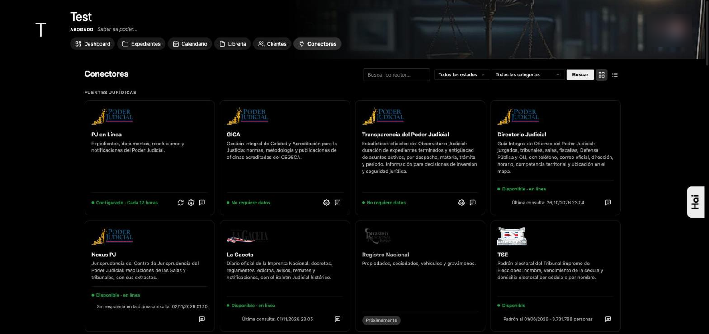
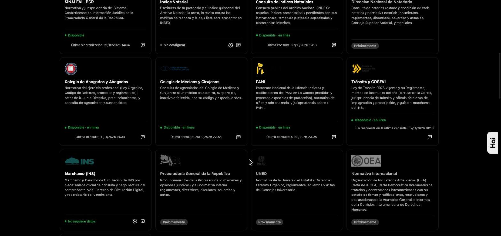

# Punto de partida (antes del 20 de noviembre de 2026, 09:00)

- Infraestructura de conectores jurídicos MCP con orquestador y Skills & Rules.
- Agente conversacional propio (Hai) y backoffice de usuarios y expedientes.
- Compatible con Claude, ChatGPT y DeepSeek vía MCP.
- 16 conectores jurídicos disponibles (PJ, Nexus, La Gaceta, SINALEVI, TSE, entre otros).

Commit o versión inicial: PENDIENTE
Capturas del prototipo (tomadas el 22/11/2026, durante el evento; no son previas al 20/11):

